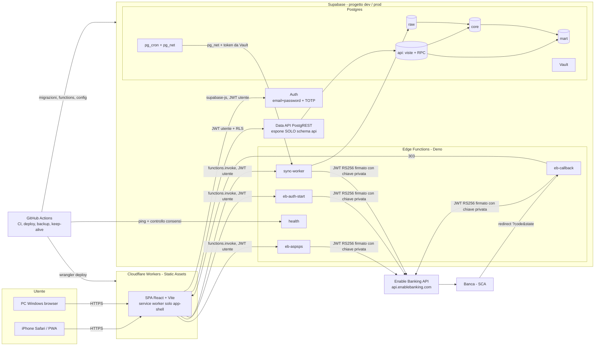
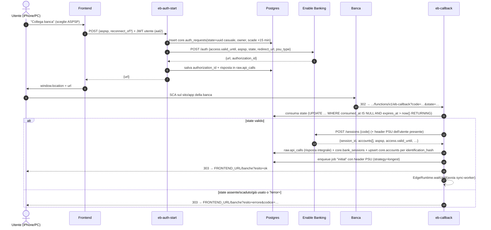
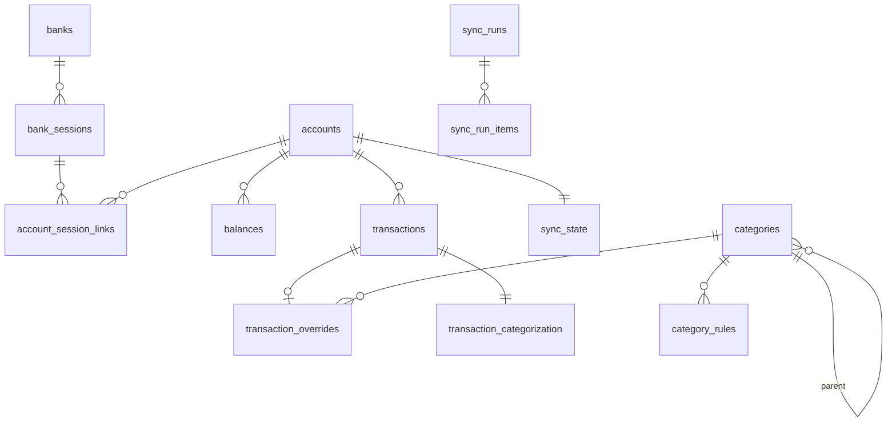
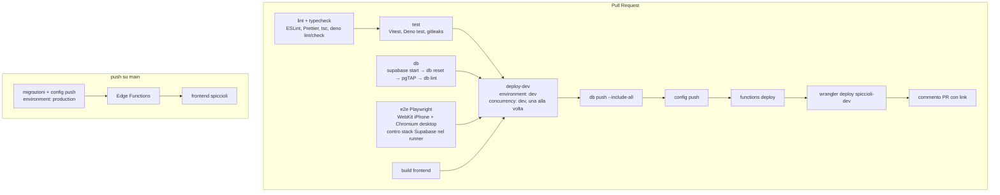

# Spiccioli — Architettura

> Stato: **proposta, in attesa di approvazione** (Fase 0 — pianificazione).
> Le scelte non banali sono motivate negli ADR in [`docs/adr/`](adr/README.md).
> Le voci marcate **[DA VERIFICARE]** non è stato possibile confermarle sulla
> documentazione ufficiale durante la pianificazione (vedi §12) e verranno
> verificate al primo contatto reale con il servizio, nella fase indicata.

## 1. Obiettivo e perimetro

Web app ad uso **esclusivamente personale** (un solo utente) che:

1. si collega ai conti bancari italiani via **Enable Banking AIS** (sola lettura);
2. scarica periodicamente saldi e movimenti e li **storicizza**;
3. permette di analizzare la spesa: categorie, trend, esercenti, ricorrenze,
   entrate vs uscite, saldo nel tempo.

Vincoli: **costo zero**, **nessuna installazione sul PC dell'utente**, deploy
**solo da GitHub Actions**, segreti bancari mai nel repo né nell'ambiente di
sviluppo dell'agente.

## 2. Componenti

| Componente | Tecnologia | Responsabilità |
|---|---|---|
| Frontend | React 19 + Vite + TypeScript strict, TanStack Query, ECharts, vite-plugin-pwa | UI mobile-first, login/MFA, dashboard, categorizzazione, export. Nessun segreto. |
| Hosting | Cloudflare Workers con Static Assets (ADR-0001) | HTTPS, SPA fallback, header di sicurezza, URL stabile per dev e prod. |
| Auth | Supabase Auth | Utente unico, registrazioni disattivate, MFA TOTP obbligatoria (ADR-0005). |
| Data API | PostgREST di Supabase | Espone **solo** lo schema `api` (ADR-0006). |
| Edge Functions | Deno, `@supabase/server`, `npm:@supabase/supabase-js@2` | Tutto ciò che tocca Enable Banking: firma JWT, auth, callback, sync. |
| Database | Postgres 17 (Supabase) | Schemi `raw` → `core` → `mart` → `api`; trasformazioni in SQL. |
| Scheduling | `pg_cron` + `pg_net` + Vault | Sync giornaliera, avanzamento dei job a blocchi, refresh materializzate. |
| CI/CD | GitHub Actions + Supabase CLI + Wrangler | Test, deploy dev su PR, deploy prod su `main`, backup, keep-alive. |

## 3. Ambienti (ADR-0002)

| | **dev** | **prod** |
|---|---|---|
| Progetto Supabase | `spiccioli-dev` (Free, UE — Francoforte) | `spiccioli-prod` (Free, UE — Francoforte) |
| Enable Banking | applicazione **SANDBOX** | applicazione **PRODUCTION** (modalità ristretta ai miei conti) |
| Frontend | Worker `spiccioli-dev` → `https://spiccioli-dev.<sottodominio>.workers.dev` | Worker `spiccioli` → `https://spiccioli.<sottodominio>.workers.dev` |
| Aggiornato da | ogni PR (dopo check verdi), **una PR alla volta** | solo merge su `main` |
| GitHub Environment | `dev` | `production` (solo branch `main`) |
| Dati | finti (sandbox), azzerabili con workflow `reset-dev` | reali, backup cifrati |

Non esiste un ambiente locale sul PC: lo "sviluppo locale" avviene nell'ambiente
dell'agente e nei runner di GitHub Actions (stack Supabase completo in Docker).

## 4. Flusso di autorizzazione bancaria (ADR-0004)

Punti chiave:

- **`state`**: UUID v4 casuale (122 bit), legato all'utente, **scadenza 15 minuti**,
  **uso singolo** (consumo atomico con `UPDATE … RETURNING`). Il callback non
  accetta nessun altro parametro dal client oltre a `code`, `state`, `error`,
  `error_description`.
- **Redirect URL** registrato su Enable Banking:
  `https://<project-ref>.supabase.co/functions/v1/eb-callback` (HTTPS, stabile,
  raggiungibile da iPhone e PC). La produzione di Enable Banking richiede HTTPS;
  un URL `*.supabase.co` lo soddisfa. Le Edge Functions non servono HTML senza
  dominio custom, quindi il callback risponde **solo con redirect 303** verso il
  frontend: nessuna pagina viene renderizzata da Supabase.
- **Tutto ciò che `POST /sessions` restituisce viene salvato subito** in
  `raw.api_calls` (alcune informazioni sono mostrate una sola volta).
- **Ricollegamento** (consenso scaduto/in scadenza): stesso flusso, con
  `reconnect_of = <bank_session_id>`; i conti vengono riconciliati per
  `identification_hash` (con fallback su `identification_hashes` e IBAN), quindi
  **non si duplicano**: cambia solo l'`uid` Enable Banking corrente, conservato
  nello storico `core.account_session_links`.
- **Durata del consenso**: `access.valid_until` = `now() + maximum_consent_validity`
  dell'ASPSP (tipicamente 180 giorni), con fallback progressivo 90/30 giorni se
  la banca rifiuta. Il valore effettivo restituito è salvato in
  `core.bank_sessions.valid_until`.

## 5. Modello dati

### 5.1 Schemi e regole di esposizione (ADR-0006)

| Schema | Esposto dalla Data API | Chi scrive | Contenuto |
|---|---|---|---|
| `raw` | **No** | solo Edge Functions (service role) | Risposte Enable Banking così come arrivano + metadati di estrazione. Append-only (trigger che vieta UPDATE/DELETE). |
| `core` | **No** | Edge Functions + funzioni SQL | Tabelle normalizzate e tipizzate. RLS attiva su tutte. |
| `mart` | **No** | funzioni SQL (refresh a fine sync) | Viste e viste materializzate analitiche. |
| `api` | **Sì (unico)** | — | Viste `security_invoker` su `core`, funzioni RPC per letture analitiche e per le poche scritture ammesse (categorie, regole, override). |
| `internal` | **No** | — | Funzioni di servizio (`SECURITY DEFINER`, `search_path` vuoto), mai chiamabili da `anon`/`authenticated`. |

`public` viene rimosso dagli schemi esposti; "Automatically expose new tables"
disattivato; `REVOKE` dei privilegi di default per `anon` su tutto.

### 5.2 Tabelle principali

Tutte le tabelle `core` hanno `owner_id uuid not null default auth.uid()
references auth.users` e una policy RLS
`owner_id = (select auth.uid()) and (select auth.jwt()->>'aal') = 'aal2'`.

| Tabella | Chiave / vincoli | Note |
|---|---|---|
| `core.banks` | `(country, name)` | Dati ASPSP da `GET /aspsps` (logo, `maximum_consent_validity`, `required_psu_headers`, `transaction_total_days`). |
| `core.auth_requests` | `state uuid` PK | `expires_at`, `consumed_at`, `authorization_id`, `reconnect_of`. Pulizia giornaliera. |
| `core.bank_sessions` | `eb_session_id` unique | `status`, `valid_until`, `created_at`, `revoked_at`, `psu_type`. |
| `core.accounts` | `(owner_id, identification_hash)` unique | ID interno stabile (uuid), `current_eb_uid`, IBAN, nome, valuta, `cash_account_type`, `include_in_analysis`, `display_name`. |
| `core.account_session_links` | `(account_id, bank_session_id)` | Storico degli `uid` Enable Banking per sessione. |
| `core.balances` | `(account_id, balance_type, reference_date)` | Un saldo per tipo e giorno (`CLBD`, `ITAV`, `XPCD`…). |
| `core.transactions` | `(account_id, dedup_key)` unique | Importo **con segno** (`DBIT` negativo), date, controparte, causale normalizzata, MCC, `status` (`BOOK`/`PDNG`), `raw_sha256`, `first_seen_run`, `last_seen_run`, `removed_at` (pending scomparsi), `internal_transfer_of`. |
| `core.categories` | `id`, `parent_id` | Gerarchia a 2 livelli; `kind` ∈ `expense`, `income`, `transfer`, `excluded`. |
| `core.category_rules` | `id` | `priority`, campo (`description`/`counterparty`/`iban`/`mcc`/`any`), operatore (`contains`/`starts_with`/`equals`/`regex`), filtri opzionali (segno, range importo, conto). |
| `core.transaction_overrides` | `transaction_id` PK | Categoria manuale, nota, `exclude_from_analysis`. Separata dalle transazioni: una ri-ingestione non la sovrascrive mai. |
| `core.transaction_categorization` | `transaction_id` PK | Risultato materializzato: `category_id`, `source` (`override`/`transfer`/`rule`/`none`), `rule_id`. Ricalcolato a fine sync e a ogni modifica di regole. |
| `core.sync_runs` | `id` | Inizio, fine, trigger (`cron`/`manual`/`initial`), stato, movimenti nuovi/aggiornati/rimossi, chiamate API, errori (jsonb). Visibile in app. |
| `core.sync_state` | `account_id` PK | Stato ripartibile: fase, `date_from` corrente, `continuation_key`, `last_booked_date`, `next_attempt_at`, `attempts`, `rate_limited_until`, `locked_until`, `last_error`. |
| `raw.api_calls` | `id bigint` | Endpoint, parametri, HTTP status, durata, `sync_run_id`, busta della risposta **completa tranne l'array dei movimenti**. |
| `raw.transactions` | `sha256` PK | Ogni oggetto movimento **così come arrivato**, deduplicato per contenuto (ADR-0007). |
| `raw.api_call_transactions` | `(api_call_id, position)` | Collega ogni risposta ai movimenti che conteneva: la risposta originale è ricostruibile byte-equivalente in JSON. |

### 5.3 Viste `mart` e `api`

- `mart.monthly_category_spend` (MV): mese × categoria × conto, importi in EUR.
- `mart.monthly_cashflow` (MV): entrate, uscite, risparmio, tasso di risparmio.
- `mart.category_trend` (vista): spesa del mese vs media mobile 12 mesi.
- `mart.top_merchants` (vista): esercente normalizzato, totale, frequenza.
- `mart.recurring_candidates` (MV): stesso esercente, importo simile (±10%),
  intervallo regolare (settimanale/mensile/annuale) con ≥3 occorrenze.
- `mart.balance_history` (vista): saldo giornaliero per conto (saldi reali +
  ricostruzione dai movimenti tra due saldi).

Le viste materializzate non supportano RLS: sono lette solo tramite funzioni
`api.*` che filtrano per `auth.uid()` e sono `SECURITY DEFINER` con
`search_path` vuoto. Le viste semplici in `api` sono `security_invoker = true`.
Il refresh avviene con `REFRESH MATERIALIZED VIEW CONCURRENTLY` a fine sync.

Il fuso orario di riferimento per mesi e giorni è `Europe/Rome`.

## 6. Strategia di sync (ADR-0008, ADR-0009)

### 6.1 Vincoli esterni

- **Edge Functions Free**: wall clock 150 s, **CPU 2 s per richiesta**,
  256 MB RAM, 30 chiamate ricorsive per trace in 60 s.
- **PSD2**: senza utente presente (nessun header PSU) le banche possono limitare
  l'accesso a **4 volte ogni 24 ore** (per consenso/conto, dipende dall'ASPSP).
  Con almeno un header PSU (`Psu-Ip-Address`, `Psu-User-Agent`, …) la richiesta è
  considerata "utente presente" e non consuma quel budget. Su
  `429 ASPSP_RATE_LIMIT_EXCEEDED` in background l'unica cosa sensata è
  riprovare dopo ~6 ore.
- **Storico**: molte banche concedono più di 90 giorni **solo subito dopo la
  SCA**. Enable Banking offre `strategy=longest` per recuperare lo storico più
  lungo disponibile; può restituire pagine vuote con `continuation_key`
  non nullo, che va comunque seguita. La `continuation_key` è valida solo nella
  sessione corrente.

### 6.2 Design

1. **Il lavoro è una coda di job in `core.sync_state`** (uno per conto). Ogni
   invocazione di `sync-worker` prende in lock (`FOR UPDATE SKIP LOCKED`,
   `locked_until`) i job pronti e lavora **pagina per pagina** con un budget di
   ~100 s di wall clock; dopo **ogni** pagina salva in transazione: risposta raw,
   ingestione in `core`, nuova `continuation_key`. Se il tempo finisce o la
   function muore, il job riparte esattamente dalla pagina successiva.
2. **La normalizzazione avviene in SQL** (`internal.ingest_transactions(api_call_id)`):
   la function Deno fa solo HTTP + un `insert` del JSON. Così resta lontana dal
   limite di 2 s di CPU e le trasformazioni restano testabili con pgTAP.
3. **Tipi di job**
   - `initial` — creato dal callback subito dopo la SCA, **con gli header PSU
     dell'utente** (salvati solo nel job e cancellati a fine job):
     `strategy=longest`, senza `date_to`.
   - `incremental` — creato dal cron giornaliero (06:15 Europe/Rome), **senza
     header PSU**: 1 chiamata saldi + transazioni da
     `max(last_booked_date) − 10 giorni` (finestra sovrapposta per i pending che
     diventano booked). Su `WRONG_TRANSACTIONS_PERIOD` si riduce la finestra.
   - `manual` — bottone "Aggiorna ora" in app: come `incremental` ma **con header
     PSU** derivati dalla richiesta dell'utente (`x-forwarded-for`, `user-agent`).
4. **Avanzamento**: `pg_cron` ogni 5 minuti esegue una query SQL che **invoca
   `sync-worker` solo se esistono job pronti** (nessuna invocazione a vuoto).
   Il callback e il bottone manuale avviano subito il worker in background
   (`EdgeRuntime.waitUntil`).
5. **Retry e backoff**: errori 5xx/rete → backoff esponenziale con jitter
   (1, 2, 4, 8 … min, max 6 h, max 8 tentativi); `429` → `rate_limited_until =
   now() + 6 h`; `401/403` di sessione (`EXPIRED_SESSION`, `REVOKED`…) → job
   sospeso, sessione marcata, avviso in app per ricollegare. Nessun dato già
   scaricato viene perso: ogni pagina è committata prima di richiedere la
   successiva.
6. **Fine run**: ricategorizzazione dei movimenti toccati, rilevazione giroconti,
   `REFRESH MATERIALIZED VIEW CONCURRENTLY`, chiusura di `core.sync_runs` con i
   conteggi.

### 6.3 Deduplica e pending → booked (ADR-0009)

- Chiave `dedup_key`, in ordine di preferenza: `entry_reference` → `transaction_id`
  → hash SHA-256 deterministico su campi stabili (`booking_date` o
  `value_date`, importo, valuta, segno, IBAN/nome controparte normalizzati,
  causale normalizzata) + **ordinale** tra movimenti identici nella stessa
  risposta (due caffè identici lo stesso giorno restano due movimenti).
- I **pending sono effimeri**: a ogni sync, per la finestra richiesta, i pending
  del conto non più restituiti vengono marcati `removed_at` (mai cancellati
  fisicamente). Un booked che "assomiglia" a un pending rimosso (stesso segno e
  importo, controparte compatibile, date entro 5 giorni) **eredita il suo
  override manuale**. In analisi i pending sono mostrati ma separabili.

## 7. Categorizzazione (ADR-0010)

Precedenza, dalla più forte:

1. **override manuale** del singolo movimento;
2. **giroconto tra miei conti** (categoria di sistema "Giroconto", esclusa da
   entrate/uscite): IBAN controparte ∈ IBAN dei miei conti, oppure coppia di
   movimenti di segno opposto e stesso importo su due miei conti entro 3 giorni;
3. **prima regola attiva** per `priority` crescente (pattern su causale,
   controparte, IBAN, MCC; filtri su segno, importo, conto);
4. "Da categorizzare".

Su iPhone: tocco sul movimento → bottom sheet con le categorie più usate +
ricerca → salvataggio immediato (1–2 tocchi) → proposta "Applica sempre a
movimenti simili?" che precompila una regola (controparte o parola chiave della
causale) con anteprima dei movimenti coinvolti.

## 8. Frontend

- **Viste**: Home (mese corrente: speso, entrate, risparmio, top categorie,
  avvisi consenso), Movimenti (card su mobile, tabella su desktop, filtri),
  Analisi (desktop: filtri completi, trend, esercenti, ricorrenze, saldo nel
  tempo), Categorie & Regole, Banche (collega/ricollega, scadenze), Sync
  (storico `sync_runs`), Export, Impostazioni.
- **Mobile-first**: `viewport-fit=cover`, `env(safe-area-inset-*)`, target
  tattili ≥ 44 px, bottom navigation, grafici ECharts con tooltip touch.
- **PWA**: manifest + icone Apple; il service worker fa **precache solo
  dell'app-shell**; tutte le chiamate a `*.supabase.co` sono `NetworkOnly`; i
  dati restano solo in memoria (TanStack Query senza persistenza). Il token di
  sessione di Supabase Auth resta nel `localStorage` (comportamento standard di
  `supabase-js`), mai dati bancari.
- **Header di sicurezza** (file `_headers`): CSP restrittiva (`connect-src` solo
  il progetto Supabase), `frame-ancestors 'none'`, `Referrer-Policy: no-referrer`,
  HSTS.
- **Export** (ADR-0014): CSV generato nel browser (UTF-8 con BOM, `;` come
  separatore per Excel italiano); Parquet generato nel browser con
  `hyparquet-writer` (pure JS, caricato on-demand), senza duckdb-wasm.

## 9. CI/CD

- **Check su PR**: lint, typecheck, test (frontend, Edge Functions, SQL con
  pgTAP sullo stack Supabase avviato nel runner), migrazioni applicate su DB
  pulito (`supabase db reset`), build, e2e, secret scanning (gitleaks), controllo
  migrazioni distruttive (vedi sotto). Poi deploy su **dev** e link nella PR.
- **Concorrenza su dev**: `concurrency: { group: deploy-dev, cancel-in-progress:
  false }` → i deploy su dev sono serializzati; il frontend dev mostra in un
  badge il numero di PR e lo SHA effettivamente deployati. Le migrazioni di una
  PR abbandonata possono "sporcare" dev: il workflow manuale **`reset-dev`**
  ricrea il DB dev da `main` (solo sandbox, dati finti).
- **Deploy prod** (merge su `main`): job concatenati con `needs` — migrazioni →
  Edge Functions → frontend. Un errore ferma i passi successivi.
- **Migrazioni additive**: uno script in CI cerca `DROP`, `RENAME`,
  `ALTER … TYPE`, `TRUNCATE`, `DELETE` senza `WHERE` nelle nuove migrazioni; se
  ne trova, il check fallisce a meno che la PR non abbia l'etichetta
  `migrazione-distruttiva-approvata`, che **metti tu** dopo aver letto la
  migrazione.
- **Altri workflow**: `reset-dev` (manuale), `backup` (schedulato, prod),
  `restore` (manuale), `keepalive` (schedulato, dev+prod).
- **Action ufficiali**: `actions/checkout`, `actions/setup-node`,
  `denoland/setup-deno`, `supabase/setup-cli`, `cloudflare/wrangler-action`,
  versioni fissate e aggiornate da Dependabot.

## 10. Segreti (ADR-0011)

| Segreto / valore | Dove | Chi lo inserisce | Segreto? |
|---|---|---|---|
| `EB_APP_ID` (dev: app sandbox, prod: app production) | Supabase → Edge Functions → Secrets | tu, dal browser | sì (non critico ma riservato) |
| `EB_PRIVATE_KEY` (PEM) | Supabase → Edge Functions → Secrets | tu, dal browser (copia/incolla dal file `.pem` scaricato) | **sì, critico** |
| `FRONTEND_URL` | Supabase → Edge Functions → Secrets | CI (`supabase secrets set`) | no |
| token del cron | Vault di Postgres | **generato dentro il DB** dalla migrazione, mai visto da nessuno | sì |
| `SUPABASE_ACCESS_TOKEN` (PAT con scope sul solo progetto) | GitHub → Environment `dev` / `production` | tu | **sì** |
| `SUPABASE_DB_PASSWORD` | GitHub → Environment `dev` / `production` | tu | **sì** |
| `SUPABASE_PROJECT_REF` | GitHub → Environment (variable) | tu | no |
| `SUPABASE_URL`, `SUPABASE_PUBLISHABLE_KEY` | GitHub → Environment (variable) | tu | no (pubblici per design) |
| `CLOUDFLARE_API_TOKEN` (permesso "Workers Scripts: Edit") | GitHub → Environment | tu | **sì** |
| `CLOUDFLARE_ACCOUNT_ID` | GitHub → Environment (variable) | tu | no |
| `BACKUP_AGE_RECIPIENT` (chiave pubblica age) | GitHub → Environment `production` (variable) | tu | no |
| `HEALTH_TOKEN` | GitHub secret + Supabase secret | tu (generato dal browser) | sì, basso impatto |

La chiave privata Enable Banking **non passa mai** da GitHub né dall'ambiente
dell'agente. Il codice accetta il PEM incollato in qualunque forma (a capo
reali, `\n` letterali, spazi): ricostruisce il base64 tra le righe
`-----BEGIN …-----`/`-----END …-----` e supporta sia PKCS#8 (`PRIVATE KEY`) sia
PKCS#1 (`RSA PRIVATE KEY`). La `service_role`/secret key è usata solo dentro le
Edge Functions (iniettata automaticamente da Supabase come
`SUPABASE_SECRET_KEYS`).

## 11. Vincoli del piano Free e stime d'uso

### 11.1 Limiti rilevanti (verificati sulla documentazione Supabase)

| Risorsa | Limite Free | Uso stimato (prod) | Margine |
|---|---|---|---|
| Progetti attivi | 2 | 2 (dev, prod) | 0 — nessun terzo progetto |
| Dimensione DB | 500 MB per progetto | ~40 MB/anno (vedi sotto) | > 10 anni |
| Edge Function invocations | 500.000/mese (per organizzazione) | < 3.000/mese | ampio |
| Edge Function wall clock / CPU | 150 s / 2 s per richiesta | ~100 s di budget per invocazione, CPU minima | design a blocchi |
| Egress | 5 GB/mese | < 200 MB/mese | ampio |
| MAU | 50.000 | 1 | — |
| Pausa per inattività | dopo 7 giorni di scarsa attività | — | cron interno + keep-alive (ADR-0013) |
| Backup | **non inclusi** sul Free | — | backup cifrati via Actions (ADR-0012) |

### 11.2 Stima della dimensione del DB

Ipotesi: 4 conti, ~200 movimenti/mese in totale, oggetto JSON medio 1,5 KB.

- `raw.transactions` (deduplicato per contenuto): 2.400 mov/anno × 1,5 KB ≈ 4 MB/anno
  (+ versioni pending→booked ≈ ×1,5) ≈ **6 MB/anno**.
- `raw.api_calls` (buste senza movimenti, ~2 KB × ~15 chiamate/giorno) ≈ **11 MB/anno**.
- `core.*` con indici ≈ **10 MB/anno**; `mart` (MV) < 5 MB.
- Storico iniziale (es. 2 anni) ≈ 20 MB una tantum.

Totale ≈ **40 MB/anno**. Senza la deduplica per contenuto (salvando ogni pagina
intera ogni giorno, finestra di 10 giorni sovrapposta) si arriverebbe a
~100+ MB/anno: è il motivo dell'ADR-0007.

### 11.3 Invocazioni Edge Functions

Cron giornaliero (1 avvio + ~1–3 avanzamenti) + aperture app (~10/giorno ×
`eb-*` solo quando si gestiscono banche) + `health` ogni 2 giorni ≈ **< 100/giorno**
per progetto.

### 11.4 GitHub Actions

Dipende da ADR-0003: repo pubblico → minuti illimitati; repo privato → 2.000
minuti/mese. Stima per PR completa (CI + e2e + deploy dev) ≈ 15 minuti; backup e
keep-alive ≈ 60 minuti/mese.

### 11.5 Cloudflare Workers Free

Le richieste agli asset statici sono gratuite e non conteggiate; nessun Worker
script lato server. Nessun limite pratico per un utente.

## 12. Verifica delle fonti

Durante la pianificazione l'ambiente dell'agente **non poteva raggiungere**
`enablebanking.com`, `supabase.com`, `developers.cloudflare.com`,
`api.cloudflare.com` (bloccati dalla policy di rete della sessione). Fonti usate:

- **Supabase**: sorgenti ufficiali della documentazione (repository
  `supabase/supabase`, `apps/docs/content/guides`, ottobre 2026): limiti Edge
  Functions, quote Free, pausa progetti, secret, scheduling con pg_cron,
  `@supabase/server`, passkey (sperimentali), schemi esposti, backup, PAT con scope.
- **Enable Banking**: esempi ufficiali (`enablebanking/enablebanking-api-samples`:
  formato JWT `typ/alg/kid`, `iss=enablebanking.com`, `aud=api.enablebanking.com`,
  endpoint `/application`, `/aspsps`, `/auth`, `/sessions`,
  `/accounts/{uid}/balances|transactions`, `continuation_key`) + estratti della
  documentazione ufficiale (FAQ, API reference, changelog) tramite motore di
  ricerca.
- **Cloudflare**, **GitHub**: estratti della documentazione ufficiale tramite
  motore di ricerca.

**[DA VERIFICARE] in Fase 3** sulla API reference completa (abilitando
`enablebanking.com` nella rete della sessione, o con una chiamata reale in
sandbox): durata massima del JWT (`exp − iat`), elenco esatto dei codici
d'errore, forma dei movimenti `PDNG`, campi esatti di `GET /aspsps`
(`required_psu_headers`, `maximum_consent_validity`, `transaction_total_days`),
presenza di `identification_hashes` nelle risposte reali delle banche italiane.

**[DA VERIFICARE] in Fase 2**: nomi esatti dei menu della dashboard Supabase e
Cloudflare per SETUP.md (li verifichiamo insieme mentre li segui).

## 13. Piano delle fasi

Una branch e una PR per fase, check verdi a ogni fase. A fine fase: riepilogo,
link dev per iPhone e PC, punti aperti, aggiornamenti a SETUP.md.

| Fase | Contenuto | Azioni manuali tue |
|---|---|---|
| 0 | Questa pianificazione (ARCHITECTURE, ADR, CLAUDE.md) | Approvazione + decisione ADR-0003 |
| 1 — Scaffolding | Struttura repo, frontend scheletro (login finto), `supabase/` con `config.toml` e prima migrazione (schemi + revoke), Edge Function `health`, CI su PR (lint, typecheck, test, db reset + pgTAP nel runner, build, e2e, gitleaks), Dependabot, bozza SETUP.md | Impostazioni repo (visibilità, Actions) |
| 2 — Cloud e CD | SETUP.md seguito passo passo: progetti Supabase, utente + TOTP, Cloudflare, secret, Environments, protezione `main`; workflow deploy-dev/prod; login reale con MFA | Dashboard Supabase, Cloudflare, GitHub |
| 3 — Enable Banking | Client EB (JWT RS256 WebCrypto, errori, retry), `eb-aspsps`, `eb-auth-start`, `eb-callback`, pagina Banche; collegamento in SANDBOX provato da iPhone e PC | Registrazione app sandbox EB + secret |
| 4 — Dati | `raw`/`core` completi, ingestione SQL, `sync-worker` a blocchi, deduplica, pg_cron, `sync_runs` + pagina Sync | — |
| 5 — Categorizzazione | Categorie, regole, override, giroconti, UI rapida su iPhone | — |
| 6 — Analisi | `mart` + dashboard responsive (essenziale su iPhone, completa su PC) | — |
| 7 — Rifiniture | PWA completa, export CSV/Parquet, avvisi consenso, backup + restore, keep-alive, OPERATIONS.md, passaggio a PRODUCTION | App production EB, chiave `age`, repo backup |
